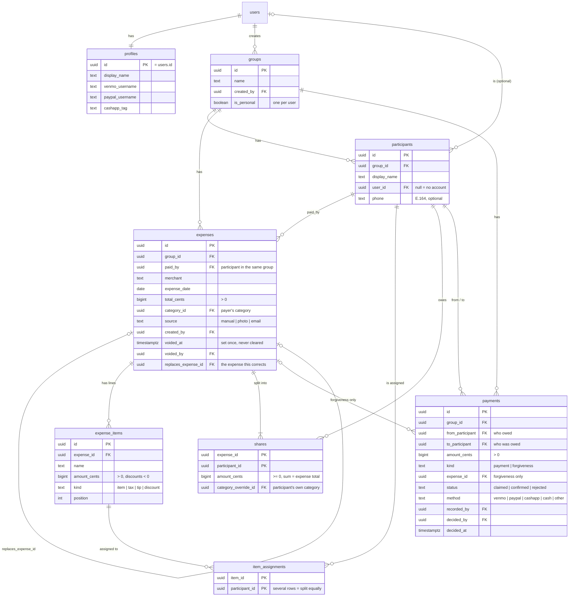
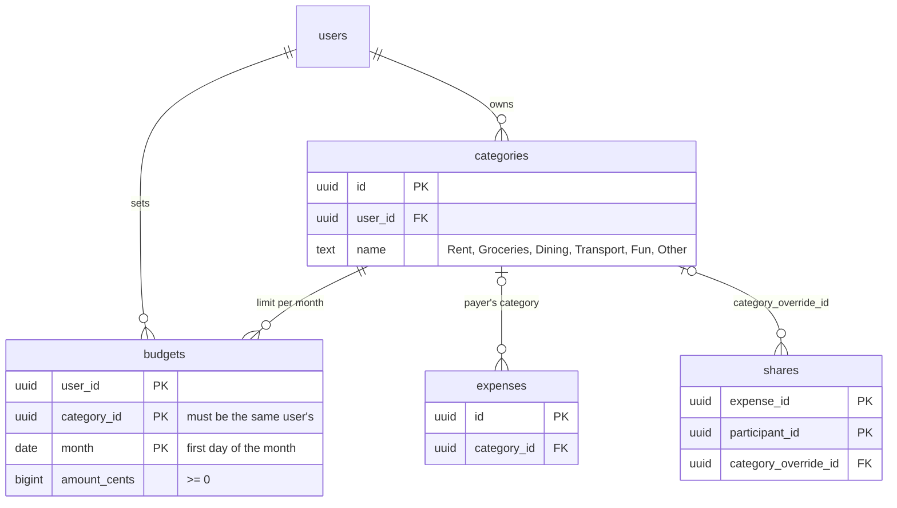
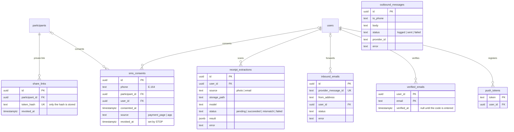
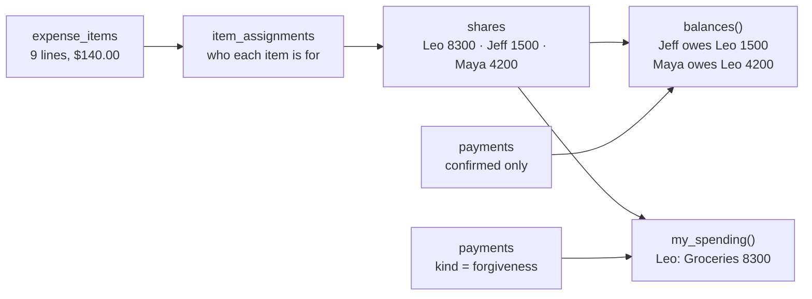

# Data model

The Supabase Postgres schema, drawn from the migrations in `supabase/migrations/`. The plan's version is in [docs/PLAN.md](docs/PLAN.md#data-model). If the two disagree, the migrations win.

`users` is Supabase's `auth.users`. All money is `bigint` cents.

## People, groups and the ledger

Every expense belongs to a group. Each user also gets an automatic Personal group containing only them.

## Budgets

## Payment page, texting, receipts, push

These tables are read and written by Edge Functions (Steps 8–11), not by the app directly.

## How money flows

Using the plan's Costco example: Leo pays $140.00, the household items are split three ways, and Maya's food is hers alone.

- **Shares** come from `computeShares` in `packages/ledger` and are saved with `save_expense`. The database rejects any expense whose shares (or items) don't add up to its total.
- **Balances** are never stored. They're calculated from shares of expenses that aren't voided, minus confirmed payments and forgiveness.
- **Spending** is your own shares plus debts you forgave. Repayments never count.

## Rules the database enforces

| Rule                               | How                                                                                                                                                                                                                                               |
| ---------------------------------- | ------------------------------------------------------------------------------------------------------------------------------------------------------------------------------------------------------------------------------------------------- |
| Money is whole cents               | `bigint` columns; amount checks (positive, discounts negative)                                                                                                                                                                                    |
| History is append-only             | No UPDATE/DELETE grants on `expenses`, `expense_items`, `item_assignments`, `shares`, `payments`, plus triggers that block changes even for the table owner. The only changes allowed are voiding an expense once and deciding a claimed payment. |
| Shares add up                      | A check at commit: shares, and items when there are any, must sum to `total_cents`                                                                                                                                                                |
| People belong to the group         | `paid_by`, `from_participant` and `to_participant` must be participants in the same group (composite foreign keys)                                                                                                                                |
| Forgiveness is the payer's to give | A forgiveness must name an expense, and its `to_participant` must be that expense's payer                                                                                                                                                         |
| Budgets use your own categories    | `budgets (category_id, user_id)` references `categories (id, user_id)`                                                                                                                                                                            |

## Who can read what

Nothing is readable without signing in. Signed-in users see:

| Data                                                   | Who                                                                                                      |
| ------------------------------------------------------ | -------------------------------------------------------------------------------------------------------- |
| Full expense, its items, assignments and shares        | The payer and whoever entered it                                                                         |
| Your part of an expense someone else paid              | You, only through `get_my_shares()`: your items and your amount, never the total or other people's items |
| Groups and their participants                          | Members of the group                                                                                     |
| Profiles                                               | You, and people who share a group with you                                                               |
| Payments                                               | The two people involved, and whoever recorded it                                                         |
| Categories, budgets, push tokens                       | Their owner                                                                                              |
| Payment links, text consents, messages, inbound emails | Edge Functions only                                                                                      |

People without accounts see their share only through the `get-share` Edge Function (Step 8), with a private link.

## Database functions

| Function                     | What it does                                                                                                                                                     |
| ---------------------------- | ---------------------------------------------------------------------------------------------------------------------------------------------------------------- |
| `save_expense(...)`          | Inserts an expense with its items, assignments and shares in one transaction. Rejects shares that don't sum to the total. Can replace (void) an earlier expense. |
| `create_group(name, people)` | Creates a group with you in it plus any name-only people, in one transaction.                                                                                    |
| `void_expense(id)`           | Marks an expense voided. Never deletes it.                                                                                                                       |
| `balances()`                 | Net who-owes-whom for every pair that includes you.                                                                                                              |
| `my_spending()`              | Your spending by month and category.                                                                                                                             |
| `get_my_shares()`            | Your items and amount on expenses other people paid.                                                                                                             |
| Signup trigger               | Creates your profile, Personal group and default categories.                                                                                                     |
| Name sync trigger            | Renaming yourself updates your name in every group you're in.                                                                                                    |
