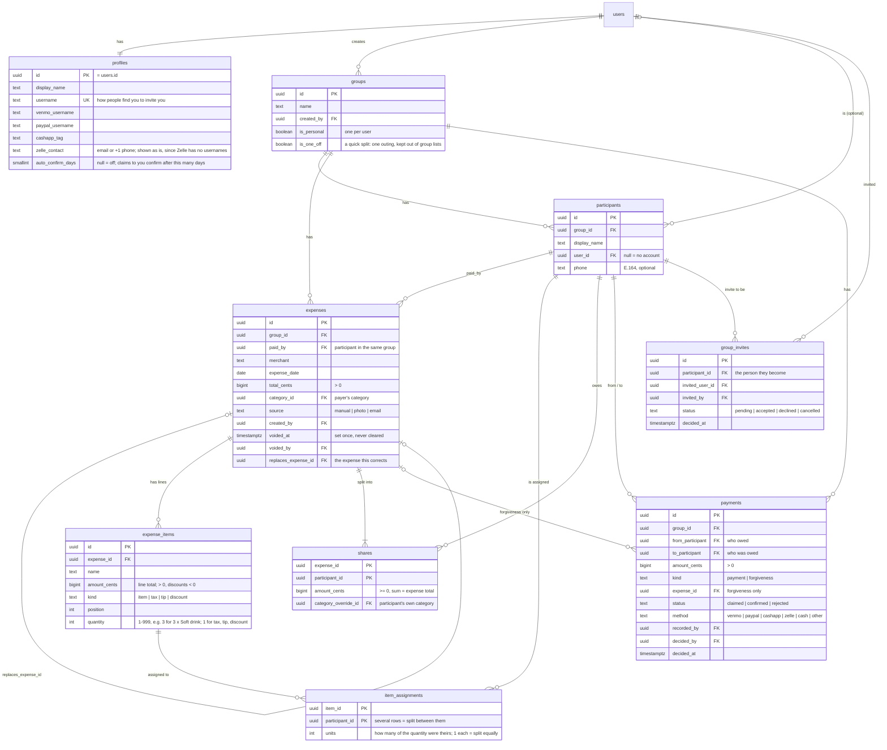
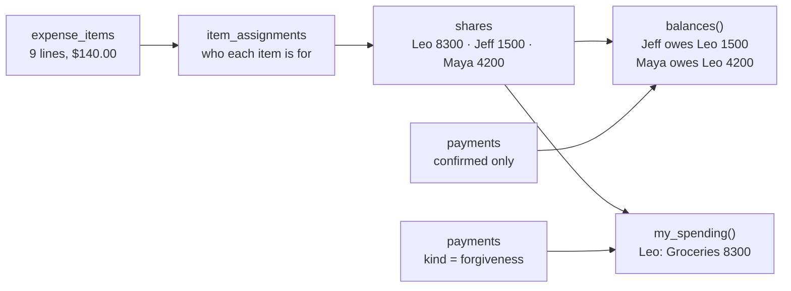

# Data model

The Supabase Postgres schema, drawn from the migrations in `supabase/migrations/`. The plan's version is in [docs/PLAN.md](docs/PLAN.md#data-model). If the two disagree, the migrations win.

`users` is Supabase's `auth.users`. All money is `bigint` cents.

## People, groups and the ledger

Every expense belongs to a group. Each user also gets an automatic Personal group containing only them.

## Budgets

## Payment page, texting, receipts, push

These tables are read and written by Edge Functions (Steps 8–11), not by the app directly. The exceptions: the app makes and revokes your payment links through `create_share_link` / `revoke_share_links`, reads problem reports sent to you, and saves its push token with `register_push_token`.

```mermaid
erDiagram
    participants ||--o{ share_links : "private link for"
    participants ||--o{ share_links : "requested by"
    participants ||--o{ problem_reports : "sends / receives"
    participants |o--o{ sms_consents : "consents"
    users |o--o{ sms_consents : "consents"
    users ||--o{ receipt_extractions : "scans"
    users |o--o{ inbound_emails : "forwards"
    users ||--o{ verified_emails : "verifies"
    users ||--o{ push_tokens : "registers"

    share_links {
        uuid id PK
        uuid participant_id FK "who the link is for (Jeff)"
        uuid requested_by FK "who's asking to be paid (Leo)"
        text token_hash UK "SHA-256 of the token; the token itself is never stored"
        timestamptz revoked_at
    }
    problem_reports {
        uuid id PK
        uuid group_id FK
        uuid from_participant FK
        uuid to_participant FK
        text message "Something looks wrong, 1-500 characters"
        timestamptz resolved_at "set when dismissed"
    }
    sms_consents {
        uuid id PK
        text phone "E.164"
        uuid participant_id FK
        uuid user_id FK
        timestamptz consented_at
        text source "payment_page | app"
        timestamptz revoked_at "set by STOP"
    }
    outbound_messages {
        uuid id PK
        text to_phone
        text body
        text status "logged | sent | failed"
        text provider_id
        text error
    }
    receipt_extractions {
        uuid id PK
        uuid user_id FK
        text source "photo | email"
        text storage_path
        text model
        text status "pending | succeeded | mismatch | failed"
        jsonb result
        text error
    }
    inbound_emails {
        uuid id PK
        text provider_message_id UK
        text from_address
        uuid user_id FK
        text status
        text error
    }
    verified_emails {
        uuid user_id PK
        text email PK
        timestamptz verified_at "null until the code is entered"
    }
    push_tokens {
        text token PK
        uuid user_id FK
    }
```

Receipt photos live in the private Storage bucket `receipts`, at `<user id>/<file>.jpg`. You can upload to and read only your own folder; `extract-receipt` reads them with the service role and logs every attempt (model, status, the draft or the error) in `receipt_extractions`. Your own extractions are readable by you.

## How money flows

Using the plan's Costco example: Leo pays $140.00, the household items are split three ways, and Maya's food is hers alone.

- **Shares** come from `computeShares` in `packages/ledger` and are saved with `save_expense`. The database rejects any expense whose shares (or items) don't add up to its total.
- **Balances** are never stored. They're calculated from shares of expenses that aren't voided, minus confirmed payments and forgiveness.
- **Spending** is your own shares plus debts you forgave. Repayments never count.

## Rules the database enforces

| Rule                               | How                                                                                                                                                                                                                                               |
| ---------------------------------- | ------------------------------------------------------------------------------------------------------------------------------------------------------------------------------------------------------------------------------------------------- |
| Money is whole cents               | `bigint` columns; amount checks (positive, discounts negative)                                                                                                                                                                                    |
| History is append-only             | No UPDATE/DELETE grants on `expenses`, `expense_items`, `item_assignments`, `shares`, `payments`, plus triggers that block changes even for the table owner. The only changes allowed are voiding an expense once and deciding a claimed payment. |
| Shares add up                      | A check at commit: shares, and items when there are any, must sum to `total_cents`                                                                                                                                                                |
| People belong to the group         | `paid_by`, `from_participant` and `to_participant` must be participants in the same group (composite foreign keys)                                                                                                                                |
| Forgiveness is the payer's to give | A forgiveness must name an expense, and its `to_participant` must be that expense's payer                                                                                                                                                         |
| Budgets use your own categories    | `budgets (category_id, user_id)` references `categories (id, user_id)`                                                                                                                                                                            |

## Who can read what

Nothing is readable without signing in. Signed-in users see:

| Data                                                   | Who                                                                                                                                     |
| ------------------------------------------------------ | --------------------------------------------------------------------------------------------------------------------------------------- |
| Full expense, its items, assignments and shares        | The payer and whoever entered it                                                                                                        |
| Your part of an expense someone else paid              | You, only through `get_my_shares()` and `my_spending_items()`: your items, amount and category, never the total or other people's items |
| Groups and their participants                          | Members of the group                                                                                                                    |
| Profiles                                               | You, and people who share a group with you                                                                                              |
| Payments                                               | The two people involved, and whoever recorded it                                                                                        |
| Invites                                                | The person who sent it, the person invited, and members of that group                                                                   |
| Categories, budgets, share filings, push tokens        | Their owner                                                                                                                             |
| Problem reports ("Something looks wrong")              | The person they were sent to                                                                                                            |
| Payment links, text consents, messages, inbound emails | Edge Functions only                                                                                                                     |

People without accounts see their share only through the `get-share` Edge Function, with a private link. The Edge Functions use the service role but only call the `link_*` functions below, which take the hash of the link's token and return just that person's items and shares on the requester's expenses behind what's owed now (newest first, until they cover it), what they owe, and the requester's payment usernames: never an expense's total, the requester's own items, or anyone else's.

## Edge Functions

| Function          | Who calls it                     | What it does                                                                                                                                                                                                                |
| ----------------- | -------------------------------- | --------------------------------------------------------------------------------------------------------------------------------------------------------------------------------------------------------------------------- |
| `get-share`       | The payment page (no sign-in)    | What a link shows (`link_share`). 60 a minute per address, 30 per link.                                                                                                                                                     |
| `claim-payment`   | The payment page                 | "I paid Leo" (`link_claim`), then a push to Leo. 5 an hour per link.                                                                                                                                                        |
| `flag-problem`    | The payment page                 | "Something looks wrong" (`link_flag`), then a push. 5 an hour per link.                                                                                                                                                     |
| `text-opt-in`     | The payment page                 | Saves or revokes the text consent, with the number the person typed (`link_text_opt_in`).                                                                                                                                   |
| `notify-claim`    | The app, after "I paid"          | Pushes "Jeff says they paid you $15.00" to the person paid, for a claim the caller made in the last 10 min.                                                                                                                 |
| `extract-receipt` | The app, after uploading a photo | Reads a receipt photo from your folder with Gemini (3.5 Flash-Lite, then 3.8 Flash) or Claude (Haiku 5.5, then Sonnet 5.5) if the lines don't add up, checks the math in code, and returns a draft. Monthly limit per user. |

## Database functions

| Function                                                    | What it does                                                                                                                                                                                                                                                                      |
| ----------------------------------------------------------- | --------------------------------------------------------------------------------------------------------------------------------------------------------------------------------------------------------------------------------------------------------------------------------- |
| `save_expense(...)`                                         | Inserts an expense with its items, assignments and shares in one transaction. Rejects shares that don't sum to the total. Items can have a quantity and per-person units (each unit tagged to someone), which must add up to the quantity. Can replace (void) an earlier expense. |
| `create_group(name, people)`                                | Creates a group with you in it plus any name-only people, in one transaction.                                                                                                                                                                                                     |
| `void_expense(id)`                                          | Marks an expense voided. Never deletes it.                                                                                                                                                                                                                                        |
| `record_payment(...)`                                       | A repayment that counts right away: recorded by the person who got paid, or by the payer when the person paid has no account.                                                                                                                                                     |
| `claim_payment(...)`                                        | "I paid" to someone with the app. Doesn't count until they confirm it.                                                                                                                                                                                                            |
| `decide_payment(id, accept)`                                | "Got it" or "Didn't get it" on a claim made to you.                                                                                                                                                                                                                               |
| `forgive_debt(group, debtor, amount)`                       | Forgives up to what someone owes you, spread over the expenses behind it, newest first.                                                                                                                                                                                           |
| `set_budget(category, month, amount)`                       | Sets your budget for a category from a month on (budgets carry forward); no amount removes it from that month on.                                                                                                                                                                 |
| `set_share_category(expense, category)`                     | Files your share of someone else's expense under one of your categories, for your budget only.                                                                                                                                                                                    |
| `my_spending_items(month)`                                  | Your spending items for a month: your shares and debts you forgave, with the total only for expenses you paid or entered.                                                                                                                                                         |
| `find_user(username)`                                       | The account with exactly that username, or nothing. No partial search, so nobody can browse users.                                                                                                                                                                                |
| `username_available(username)`                              | Whether a username is free for you.                                                                                                                                                                                                                                               |
| `add_person(group, name, phone, invite_user_id)`            | Adds a person to a group, and invites an account to be them if given.                                                                                                                                                                                                             |
| `invite_to_group(participant, user)`                        | Invites an account to be a name-only person in your group.                                                                                                                                                                                                                        |
| `respond_to_invite(invite, accept)`                         | Accepting makes you that person, so the group's expenses, including earlier ones, show in your account.                                                                                                                                                                           |
| `cancel_invite(invite)`, `my_invites()`                     | Cancel an invite you sent; list the ones waiting for you.                                                                                                                                                                                                                         |
| `create_share_link(person)`                                 | A new private payment link for someone in your group. Returns the token once; older links keep working.                                                                                                                                                                           |
| `revoke_share_links(person)`, `active_share_links(person)`  | Turn off every link you made for someone; count the working ones.                                                                                                                                                                                                                 |
| `resolve_problem(report)`                                   | Dismisses a "Something looks wrong" note sent to you.                                                                                                                                                                                                                             |
| `register_push_token(token)`                                | Saves this phone's Expo push token to your account (moving it from whoever used the phone before).                                                                                                                                                                                |
| `link_share`, `link_claim`, `link_flag`, `link_text_opt_in` | Edge Functions only: the payment page's reads and writes, by the hash of a link token.                                                                                                                                                                                            |
| `receipt_scans_this_month(user)`                            | Edge Functions only: photos scanned this month, for the monthly limit (a retry counts once).                                                                                                                                                                                      |
| `hit_rate_limit(key, max, seconds)`                         | Edge Functions only: counts a hit and says whether it's within the limit.                                                                                                                                                                                                         |
| Auto-confirm job (`pg_cron`, hourly)                        | Confirms claims older than the recipient's `auto_confirm_days`, for people who turned it on.                                                                                                                                                                                      |
| `balances()`                                                | Net who-owes-whom for every pair that includes you.                                                                                                                                                                                                                               |
| `my_spending()`                                             | Your spending by month and category.                                                                                                                                                                                                                                              |
| `get_my_shares()`                                           | Your items, amount and category (how you filed it) on expenses other people paid. Each item says its quantity and, if tagged one by one, how many were yours ("your 1 of 3"), never whose the rest were.                                                                          |
| Signup trigger                                              | Creates your profile, Personal group and default categories.                                                                                                                                                                                                                      |
| Name sync trigger                                           | Renaming yourself updates your name in every group you're in.                                                                                                                                                                                                                     |
