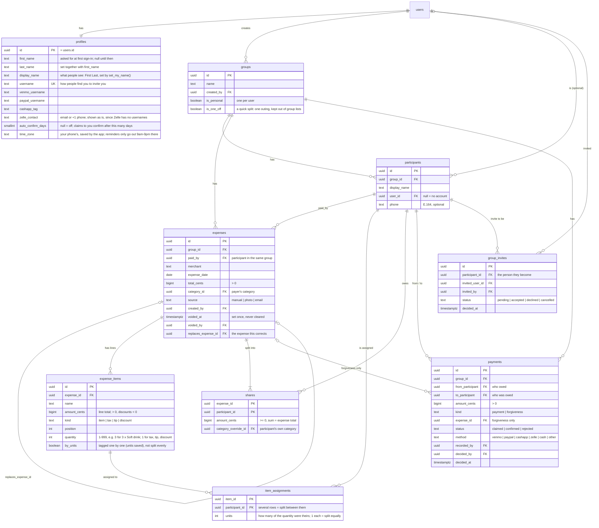
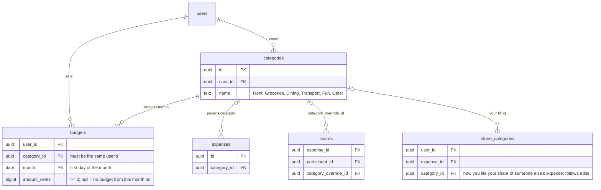
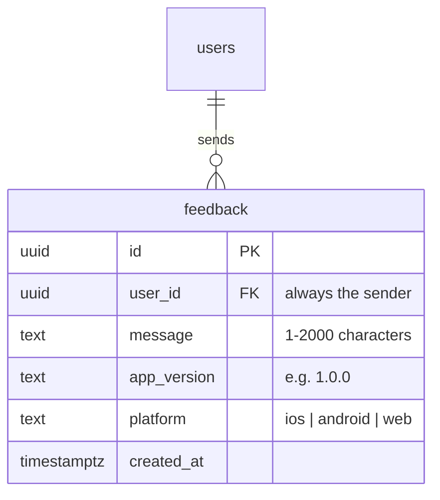
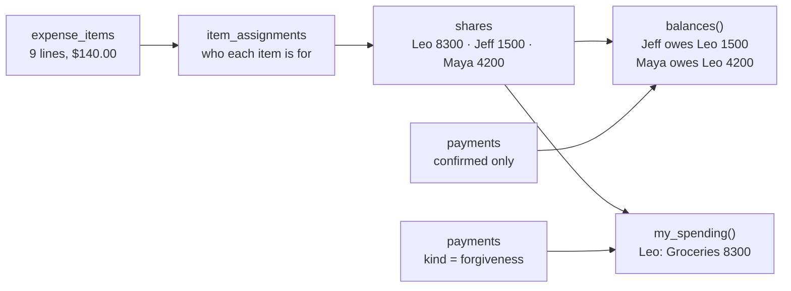

# Data model

The Supabase Postgres schema, drawn from the migrations in `supabase/migrations/`. The plan's version is in [docs/PLAN.md](docs/PLAN.md#data-model). If the two disagree, the migrations win.

`users` is Supabase's `auth.users`. All money is `bigint` cents.

## People, groups and the ledger

Every expense belongs to a group. Each user also gets an automatic Personal group containing only them.

## Budgets

## Payment page, texting, receipts, push

These tables are read and written by Edge Functions (Steps 8–11), not by the app directly. The exceptions: the app makes and revokes your payment links through `create_share_link` / `revoke_share_links`, reads problem reports sent to you, and saves its push token with `register_push_token`.

```mermaid
erDiagram
    participants ||--o{ share_links : "private link for"
    participants ||--o{ share_links : "requested by"
    participants ||--o{ problem_reports : "sends / receives"
    participants |o--o{ sms_consents : "consents"
    users |o--o{ sms_consents : "consents"
    users ||--o{ receipt_extractions : "scans"
    expenses ||--o| expense_receipts : "photo"
    users |o--o{ inbound_emails : "forwards"
    users ||--o{ verified_emails : "verifies"
    users ||--o{ push_tokens : "registers"
    participants ||--o{ reminders : "owes / is owed"
    outbound_messages |o--o| reminders : "sent as"

    share_links {
        uuid id PK
        uuid participant_id FK "who the link is for (Jeff)"
        uuid requested_by FK "who's asking to be paid (Leo)"
        text token_hash UK "SHA-256 of the token; the token itself is never stored"
        timestamptz revoked_at
    }
    problem_reports {
        uuid id PK
        uuid group_id FK
        uuid from_participant FK
        uuid to_participant FK
        text message "Something looks wrong, 1-500 characters"
        timestamptz resolved_at "set when dismissed"
    }
    sms_consents {
        uuid id PK
        text phone "E.164"
        uuid participant_id FK
        uuid user_id FK
        timestamptz consented_at
        text source "payment_page | app"
        timestamptz revoked_at "set by STOP"
    }
    outbound_messages {
        uuid id PK
        text to_phone
        text body
        text status "logged | sent | failed"
        text provider_id
        text error
    }
    reminders {
        uuid id PK
        uuid group_id FK
        uuid debtor_id FK
        uuid creditor_id FK
        bigint amount_cents
        text channel "push | text | nudge"
        uuid outbound_message_id FK "the text, if it was one"
        timestamptz created_at "at most one per debt every 3 days"
    }
    expense_receipts {
        uuid expense_id PK "an edit copies it to the new version"
        text storage_path "receipts/<uploader id>/<file>.jpg"
        uuid attached_by FK "whoever entered the expense"
    }
    receipt_extractions {
        uuid id PK
        uuid user_id FK
        text source "photo | email"
        text storage_path
        text model
        text status "pending | succeeded | mismatch | unreadable | failed"
        jsonb result
        text error
    }
    inbound_emails {
        uuid id PK
        text provider_message_id UK "Hash of envelope sender and Message-ID: each email is read once"
        text from_address
        text subject
        uuid user_id FK
        text status "received | processing | drafted | duplicate | unknown_sender | forwarding_code | failed"
        text error
    }
    verified_emails {
        uuid user_id PK
        text email PK
        timestamptz verified_at "null until the code is entered"
        boolean is_sign_in "the sign-in address: added automatically, can't be removed"
    }
    receipt_drafts {
        uuid id PK
        uuid user_id FK
        uuid inbound_email_id FK
        text status "ok | mismatch"
        jsonb receipt "the draft, as extract-receipt returns it"
        bigint gap_cents "lines minus total when they don't add up"
        timestamptz dismissed_at
        timestamptz used_at "saved as an expense"
    }
    forwarding_codes {
        uuid id PK
        uuid user_id FK
        text code "Gmail's forwarding confirmation code"
        timestamptz dismissed_at
    }
    push_tokens {
        text token PK
        uuid user_id FK
    }
```

Receipt photos go to the private Storage bucket `receipts`, at `<user id>/<file>.jpg`. You can upload to, read and delete only your own folder. `extract-receipt` reads a photo with the service role; one that reads as a receipt is kept, and one that doesn't is deleted (if an upload never reaches the function, the app deletes it). Saving the expense with "Keep the photo" attaches it with `attach_receipt` (a row in `expense_receipts`), and from then on everyone who can see the expense can read the photo, through a Storage policy that checks `can_see_expense`. An edit keeps the original's photo. Saving without it deletes it, and `clean-receipts` deletes photos more than a day old that no expense uses. Every attempt is logged in `receipt_extractions` with its model, status (`succeeded`, `mismatch`, `unreadable`, or `failed` for problems on our side) and the draft or error. Your own extractions are readable by you.

## Feedback

What people send from Me → Send feedback. Anyone signed in can send it (always as themselves), but nobody can read, change or delete it through the app, not even their own. You read it in the Supabase dashboard's Table Editor.

## How money flows

Using the plan's Costco example: Leo pays $140.00, the household items are split three ways, and Maya's food is hers alone.

- **Shares** come from `computeShares` in `packages/ledger` and are saved with `save_expense`. The database rejects any expense whose shares (or items) don't add up to its total.
- **Balances** are never stored. They're calculated from shares of expenses that aren't voided, minus confirmed payments and forgiveness.
- **Spending** is your own shares plus debts you forgave. Repayments never count.

## Rules the database enforces

| Rule                               | How                                                                                                                                                                                                                                                                   |
| ---------------------------------- | --------------------------------------------------------------------------------------------------------------------------------------------------------------------------------------------------------------------------------------------------------------------- |
| Money is whole cents               | `bigint` columns; amount checks (positive, discounts negative)                                                                                                                                                                                                        |
| History is append-only             | No UPDATE/DELETE grants on `expenses`, `expense_items`, `item_assignments`, `shares`, `payments`, `expense_receipts`, plus triggers that block changes even for the table owner. The only changes allowed are voiding an expense once and deciding a claimed payment. |
| Shares add up                      | A check at commit: shares, and items when there are any, must sum to `total_cents`                                                                                                                                                                                    |
| People belong to the group         | `paid_by`, `from_participant` and `to_participant` must be participants in the same group (composite foreign keys)                                                                                                                                                    |
| Forgiveness is the payer's to give | A forgiveness must name an expense, and its `to_participant` must be that expense's payer                                                                                                                                                                             |
| Budgets use your own categories    | `budgets (category_id, user_id)` references `categories (id, user_id)`                                                                                                                                                                                                |

## Who can read what

Nothing is readable without signing in. Signed-in users see:

| Data                                                   | Who                                                                                                                                                                                                                                                                                                      |
| ------------------------------------------------------ | -------------------------------------------------------------------------------------------------------------------------------------------------------------------------------------------------------------------------------------------------------------------------------------------------------- |
| Full expense, its items, assignments and shares        | Everyone in the expense's group (groups are transparent, Rule 5), and whoever entered it, except `expenses.category_id` and `shares.category_override_id`: categories stay private, so each person gets their own through `my_category_for()`. Only the payer or whoever entered it can edit or void it. |
| How you filed your share of someone else's expense     | You, through `get_my_shares()` and `my_spending_items()`                                                                                                                                                                                                                                                 |
| Groups and their participants                          | Members of the group                                                                                                                                                                                                                                                                                     |
| Profiles                                               | You, and people who share a group with you                                                                                                                                                                                                                                                               |
| Payments                                               | The two people involved, and whoever recorded it                                                                                                                                                                                                                                                         |
| Invites                                                | The person who sent it, the person invited, and members of that group                                                                                                                                                                                                                                    |
| Categories, budgets, share filings, push tokens        | Their owner                                                                                                                                                                                                                                                                                              |
| Receipt photos kept with an expense                    | Everyone in the expense's group, like the expense itself (Rule 5)                                                                                                                                                                                                                                        |
| Problem reports ("Something looks wrong")              | The person they were sent to                                                                                                                                                                                                                                                                             |
| Feedback                                               | Nobody through the app; the Supabase dashboard only                                                                                                                                                                                                                                                      |
| Payment links, text consents, messages, inbound emails | Edge Functions only                                                                                                                                                                                                                                                                                      |

People without accounts see the bills behind what they owe only through the `get-share` Edge Function, with a private link. The Edge Functions use the service role but only call the `link_*` functions below, which take the hash of the link's token. `link_share` returns, for the requester's expenses behind what's owed now (newest first, until they cover it), each bill in full: every item with who it was for, tax, tip and discounts, the total and everyone's shares. People in it are labelled `p001`, `p002`… in the same order as their ids (so the page's breakdown rounds exactly like the saved shares), never by their real ids. It also returns what's owed and the requester's payment usernames. People outside the group see nothing.

## Edge Functions

| Function          | Who calls it                                | What it does                                                                                                                                                                                                                                                                                                                                                                                                                                                                     |
| ----------------- | ------------------------------------------- | -------------------------------------------------------------------------------------------------------------------------------------------------------------------------------------------------------------------------------------------------------------------------------------------------------------------------------------------------------------------------------------------------------------------------------------------------------------------------------- |
| `get-share`       | The payment page (no sign-in)               | What a link shows (`link_share`). 60 a minute per address, 30 per link.                                                                                                                                                                                                                                                                                                                                                                                                          |
| `claim-payment`   | The payment page                            | "I paid Leo" (`link_claim`), then a push to Leo. 5 an hour per link.                                                                                                                                                                                                                                                                                                                                                                                                             |
| `flag-problem`    | The payment page                            | "Something looks wrong" (`link_flag`), then a push. 5 an hour per link.                                                                                                                                                                                                                                                                                                                                                                                                          |
| `text-opt-in`     | The payment page                            | Saves or revokes the text consent, with the number the person typed (`link_text_opt_in`).                                                                                                                                                                                                                                                                                                                                                                                        |
| `notify-claim`    | The app, after "I paid"                     | Pushes "Jeff says they paid you $15.00" to the person paid, for a claim the caller made in the last 10 min.                                                                                                                                                                                                                                                                                                                                                                      |
| `extract-receipt` | The app, after uploading a photo            | Reads a receipt photo from your folder with Gemini (3.5 Flash-Lite, then 3.8 Flash) or Claude (Haiku 5.5, then Sonnet 5.5) if the lines don't add up, checks the math in code, and returns a draft. Monthly limit per user.                                                                                                                                                                                                                                                      |
| `scan-allowance`  | The app, on Add expense                     | Receipt scans you have left this month and when they reset (the 1st, UTC), from the same limit and count as `extract-receipt`.                                                                                                                                                                                                                                                                                                                                                   |
| `inbound-email`   | The Cloudflare Email Worker (shared secret) | A forwarded email, raw: finds whose it is from a verified address it provably came from (the From address when SPF, DKIM or DMARC passed for its domain, or the SPF-checked envelope sender, which is how Gmail filters forward). Only DKIM signatures it verifies itself and Cloudflare's ARC-sealed results count, never headers in the email. Reads it like a scan; skips duplicates; drafts it under Needs you. Unknown senders get one reply a day. Never stores the email. |
| `send-reminders`  | `pg_cron`, hourly (shared secret)           | Sends what `due_reminders()` lists: a push to someone with the app, a text through `sendText()` with a new payment link to someone who opted in, or a push to the person owed to remind them themselves. Records each in `reminders`; a text that didn't go out is tried again next hour.                                                                                                                                                                                        |
| `sms-inbound`     | Twilio or Telnyx (the provider's signature) | A reply to a text: STOP, or another way of saying it, withdraws every consent for that number.                                                                                                                                                                                                                                                                                                                                                                                   |
| `clean-receipts`  | `pg_cron`, daily (shared secret)            | Deletes receipt photos more than a day old that no expense uses (`unattached_receipts`): scans never saved, saved without the photo, or scanned again.                                                                                                                                                                                                                                                                                                                           |
| `add-email`       | The app                                     | Emails a 6-digit code to an address you want to forward from (Resend hosted, Mailpit locally).                                                                                                                                                                                                                                                                                                                                                                                   |

## Database functions

| Function                                                         | What it does                                                                                                                                                                                                                                                                                                                                                                                               |
| ---------------------------------------------------------------- | ---------------------------------------------------------------------------------------------------------------------------------------------------------------------------------------------------------------------------------------------------------------------------------------------------------------------------------------------------------------------------------------------------------- |
| `save_expense(...)`                                              | Inserts an expense with its items, assignments and shares in one transaction. Rejects shares that don't sum to the total. Items can have a quantity and per-person units (each unit tagged to someone), which must add up to the quantity. Can replace (void) an earlier expense.                                                                                                                          |
| `create_group(name, people)`                                     | Creates a group with you in it plus any name-only people, in one transaction.                                                                                                                                                                                                                                                                                                                              |
| `void_expense(id)`                                               | Marks an expense voided. Never deletes it.                                                                                                                                                                                                                                                                                                                                                                 |
| `record_payment(...)`                                            | A repayment that counts right away: recorded by the person who got paid, or by the payer when the person paid has no account.                                                                                                                                                                                                                                                                              |
| `claim_payment(...)`                                             | "I paid" to someone with the app. Doesn't count until they confirm it.                                                                                                                                                                                                                                                                                                                                     |
| `decide_payment(id, accept)`                                     | "Got it" or "Didn't get it" on a claim made to you.                                                                                                                                                                                                                                                                                                                                                        |
| `forgive_debt(group, debtor, amount)`                            | Forgives up to what someone owes you, spread over the expenses behind it, newest first.                                                                                                                                                                                                                                                                                                                    |
| `set_budget(category, month, amount)`                            | Sets your budget for a category from a month on (budgets carry forward); no amount removes it from that month on.                                                                                                                                                                                                                                                                                          |
| `set_share_category(expense, category)`                          | Files your share of someone else's expense under one of your categories, for your budget only.                                                                                                                                                                                                                                                                                                             |
| `my_spending_items(month)`                                       | Your spending items for a month: your shares and debts you forgave, each with its expense's total.                                                                                                                                                                                                                                                                                                         |
| `set_my_name(first, last)`                                       | Your first and last name (both required, up to 40 characters each), and the name people see, "First Last", which renames you in your groups. The only way names change.                                                                                                                                                                                                                                    |
| `find_user(username)`                                            | The account with exactly that username, or nothing. No partial search, so nobody can browse users.                                                                                                                                                                                                                                                                                                         |
| `username_available(username)`                                   | Whether a username is free for you.                                                                                                                                                                                                                                                                                                                                                                        |
| `add_person(group, name, phone, invite_user_id)`                 | Adds a person to a group, and invites an account to be them if given.                                                                                                                                                                                                                                                                                                                                      |
| `invite_to_group(participant, user)`                             | Invites an account to be a name-only person in your group.                                                                                                                                                                                                                                                                                                                                                 |
| `respond_to_invite(invite, accept)`                              | Accepting makes you that person, so the group's expenses, including earlier ones, show in your account.                                                                                                                                                                                                                                                                                                    |
| `cancel_invite(invite)`, `my_invites()`                          | Cancel an invite you sent; list the ones waiting for you.                                                                                                                                                                                                                                                                                                                                                  |
| `create_share_link(person)`                                      | A new private payment link for someone in your group. Returns the token once; older links keep working.                                                                                                                                                                                                                                                                                                    |
| `revoke_share_links(person)`, `active_share_links(person)`       | Turn off every link you made for someone; count the working ones.                                                                                                                                                                                                                                                                                                                                          |
| `resolve_problem(report)`                                        | Dismisses a "Something looks wrong" note sent to you.                                                                                                                                                                                                                                                                                                                                                      |
| `register_push_token(token)`                                     | Saves this phone's Expo push token to your account (moving it from whoever used the phone before).                                                                                                                                                                                                                                                                                                         |
| `link_share`, `link_claim`, `link_flag`, `link_text_opt_in`      | Edge Functions only: the payment page's reads and writes, by the hash of a link token.                                                                                                                                                                                                                                                                                                                     |
| `attach_receipt(expense, path)`                                  | Keeps a photo you scanned with an expense you entered, once. The photo must be in your own folder.                                                                                                                                                                                                                                                                                                         |
| `unattached_receipts(older_than)`                                | Edge Functions only: receipt photos uploaded before then that no expense uses, for `clean-receipts`.                                                                                                                                                                                                                                                                                                       |
| `receipt_scans_this_month(user)`                                 | Edge Functions only: photos scanned and emails read this month, for the monthly limit (a retry counts once).                                                                                                                                                                                                                                                                                               |
| `verify_email(email, code)`, `remove_email(email)`               | Confirm an address you added with its code; remove one (not your sign-in address).                                                                                                                                                                                                                                                                                                                         |
| `close_draft(draft, used)`, `dismiss_forwarding_code(id)`        | Done with a forwarded receipt (saved as an expense, or dismissed); done with a Gmail code.                                                                                                                                                                                                                                                                                                                 |
| `email_code_create`, `inbound_find_user`, `inbound_is_duplicate` | Edge Functions only: a code for an added address; whose verified address an email is from; whether a receipt was already drafted or saved.                                                                                                                                                                                                                                                                 |
| `set_time_zone(zone)`                                            | Saves your phone's time zone (it must be a real one).                                                                                                                                                                                                                                                                                                                                                      |
| `due_reminders(now)`                                             | Edge Functions only: debts to remind about now. Unpaid for more than 3 days (going by the oldest expense still unpaid, with payments covering the oldest first), owed to someone with an account, not reminded about in 3 days, no "I paid" waiting, and between 9am and 9pm for the person owed (without a time zone, in both New York and Los Angeles). Says how: push, text (with the number) or nudge. |
| Reminders job (`pg_cron`, hourly)                                | Calls `send-reminders` with `pg_net`, using the Vault secrets `project_url` and `cron_secret`. Does nothing until they're set.                                                                                                                                                                                                                                                                             |
| `hit_rate_limit(key, max, seconds)`                              | Edge Functions only: counts a hit and says whether it's within the limit.                                                                                                                                                                                                                                                                                                                                  |
| Auto-confirm job (`pg_cron`, hourly)                             | Confirms claims older than the recipient's `auto_confirm_days`, for people who turned it on.                                                                                                                                                                                                                                                                                                               |
| `balances()`                                                     | Net who-owes-whom for every pair in your groups (groups are transparent).                                                                                                                                                                                                                                                                                                                                  |
| `my_spending()`                                                  | Your spending by month and category.                                                                                                                                                                                                                                                                                                                                                                       |
| `my_category_for(expense)`                                       | Your category for an expense: how you filed your share, else the one set when it was saved, else the expense's if you paid. Other people's categories aren't readable.                                                                                                                                                                                                                                     |
| `get_my_shares()`                                                | Your shares of expenses other people paid, with your category for each (how you filed it). The full bills are readable directly, since groups are transparent.                                                                                                                                                                                                                                             |
| Signup trigger                                                   | Creates your profile, Personal group and default categories.                                                                                                                                                                                                                                                                                                                                               |
| Name sync trigger                                                | Renaming yourself updates your name in every group you're in.                                                                                                                                                                                                                                                                                                                                              |
